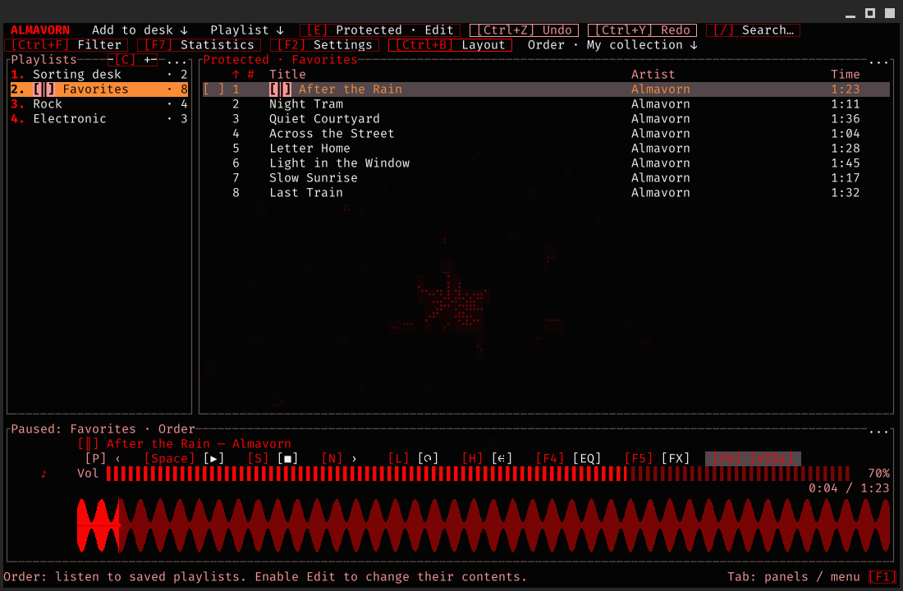
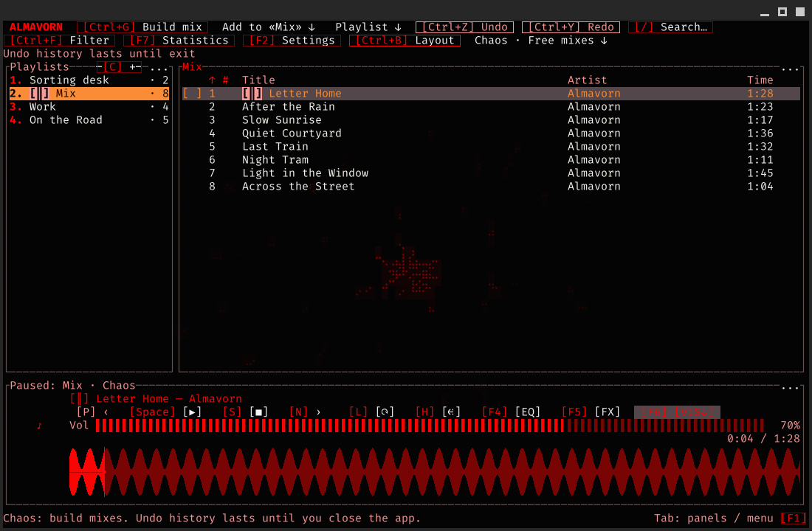

# Almavorn

[English](README.md) | [Русский](README.ru.md)

A local music player for Linux, inspired by AIMP and Strawberry.
Keep your collection organized and build new mixes freely.



## Order, Chaos, and the sorting desk

- **Order — my collection.** Playlists are protected from accidental changes. Choose "Edit" to make changes, then "Done" to lock the playlist again. Sorting the view preserves the saved track order.
- **Chaos — free mixes.** Rearrange tracks and build new playlists from existing ones. Undo and redo remain available until you close the player.
- **Sorting desk — organize new music.** A shared playlist available in both modes. Add files, correct titles, tags, and artwork, then copy tracks into the playlists you want.

Shuffle is a separate playback option available in both modes.

The tag editor writes changes to the audio file itself. Those changes affect that file in every playlist.



## Features

- Find your music with search, filters, and sorting.
- Shape your sound with equalizer, tempo, and pitch.
- Control playback with media keys while the window is minimized.
- Choose themes, fonts, and a comfortable panel layout.
- Add cover artwork and animations to the player background.
- Open keyboard help while your music keeps playing.

## Choose a download

The packaged release is **0.1.4**, for 64-bit Linux on Intel/AMD.

- **GUITUI** — a desktop window with mouse and keyboard controls: [tar.gz](https://github.com/Molten-Zharr/Almavorn/releases/download/v0.1.4/almavorn-0.1.4-guitui-linux-x86_64.tar.gz) · [AppImage](https://github.com/Molten-Zharr/Almavorn/releases/download/v0.1.4/almavorn-0.1.4-guitui-linux-x86_64.AppImage) · [Flatpak](https://github.com/Molten-Zharr/Almavorn/releases/download/v0.1.4/almavorn-0.1.4-guitui-linux-x86_64.flatpak).
- **TUI** — the interface in your terminal: [tar.gz](https://github.com/Molten-Zharr/Almavorn/releases/download/v0.1.4/almavorn-0.1.4-tui-linux-x86_64.tar.gz) · [AppImage](https://github.com/Molten-Zharr/Almavorn/releases/download/v0.1.4/almavorn-0.1.4-tui-linux-x86_64.AppImage) · [Flatpak](https://github.com/Molten-Zharr/Almavorn/releases/download/v0.1.4/almavorn-0.1.4-tui-linux-x86_64.flatpak).

Choose one interface and one format:

- **tar.gz** — an archive with an installer and menu shortcut.
- **AppImage** — a single file you run without installing.
- **Flatpak** — install the app with its required components.

If Almavorn is already installed, keep using the same format. Flatpak has separate libraries and settings for TUI and GUITUI; these are also separate from the other installation methods.

## Install

### tar.gz — install with a menu shortcut

The installer needs Python 3.

1. Download and extract the archive for your chosen interface.
2. Open the extracted folder containing "install.py".
3. Open a terminal in that folder and run:

   ```sh
   python3 install.py
   ```

4. Open "Almavorn" or "Almavorn TUI" from your application menu.

You can also start TUI from a terminal:

```sh
~/.local/bin/almavorn-tui
```

### AppImage — run a single file

1. Download the AppImage for your chosen interface.
2. Allow execution as a program in the file's properties.
3. For GUITUI, double-click the file to launch it.

For TUI, open a terminal in the folder containing the file and run:

```sh
./almavorn-0.1.4-tui-linux-x86_64.AppImage
```

Keep the AppImage in a convenient folder: you will use that same file to launch the player again.

### Flatpak — install a package

1. If you have not set up Flatpak, follow the [instructions for your distribution](https://flathub.org/en/setup).
2. Download the ".flatpak" file for your chosen interface. The first installation needs an internet connection.
3. Open a terminal in the download folder and run the commands for your interface.

GUITUI:

```sh
flatpak install --user --or-update ./almavorn-0.1.4-guitui-linux-x86_64.flatpak
flatpak run io.github.MoltenZharr.Almavorn
```

TUI:

```sh
flatpak install --user --or-update ./almavorn-0.1.4-tui-linux-x86_64.flatpak
flatpak run io.github.MoltenZharr.Almavorn.TUI
```

Confirm installation and the requested downloads. The player will then appear in your application menu.

### Build and install the current source

The automatic installer supports Ubuntu, Debian, Arch Linux, and Artix on Intel/AMD x86_64. It downloads the source and installs the required components along with the player.

1. Open a terminal.
2. Run one command for your chosen interface.

GUITUI:

```sh
curl -fsSL https://raw.githubusercontent.com/Molten-Zharr/Almavorn/main/install.sh | bash -s -- --variant guitui
```

TUI:

```sh
curl -fsSL https://raw.githubusercontent.com/Molten-Zharr/Almavorn/main/install.sh | bash -s -- --variant tui
```

3. Enter your administrator password if requested. Password characters are not displayed in the terminal.
4. Wait for installation to finish, then open the player from your application menu.

If "curl" is unavailable, download the [installer](https://raw.githubusercontent.com/Molten-Zharr/Almavorn/main/install.sh) in your browser. Open a terminal in its folder and run "bash install.sh --variant guitui" or "bash install.sh --variant tui".

## First launch

1. Choose "Add to desk" and select files or a folder.
2. Select a track and press Space to start playback.
3. Press F2 for settings or F1 for the full help guide.

Use the sorting desk to organize new music before adding it to permanent playlists.

## Update

Close the running player and update **the same interface using the same method**:

- **tar.gz:** extract the new archive and run its "install.py".
- **AppImage:** download the new file, allow execution, and launch it.
- **Flatpak:** download the new package from [Releases](https://github.com/Molten-Zharr/Almavorn/releases) and repeat the install command with its filename.
- **Source build:** repeat your installation command.

[All releases](https://github.com/Molten-Zharr/Almavorn/releases) · [Keyboard shortcuts](docs/GLOBAL_SHORTCUTS.md) · [MIT license](LICENSE)
