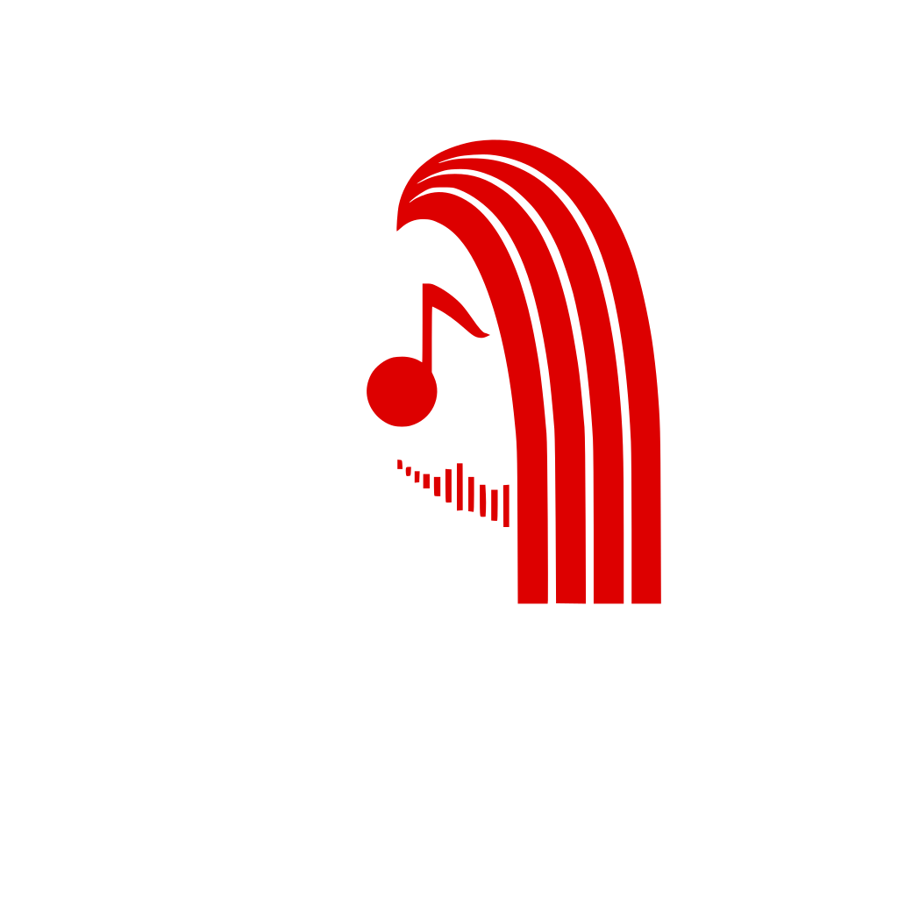
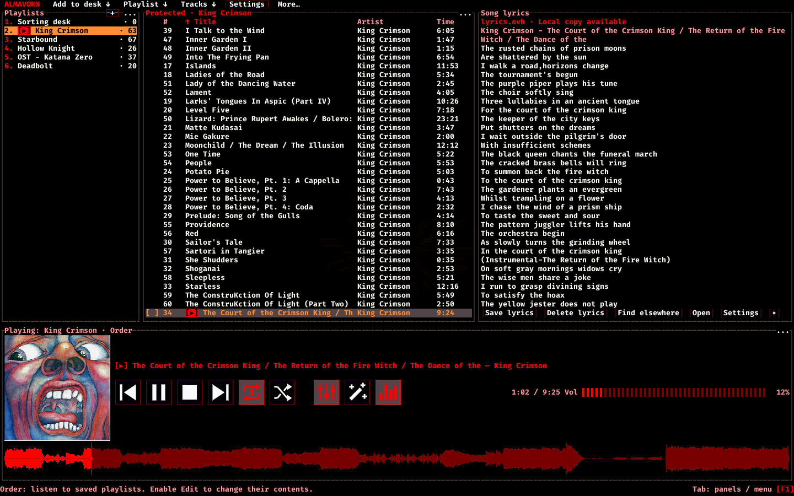
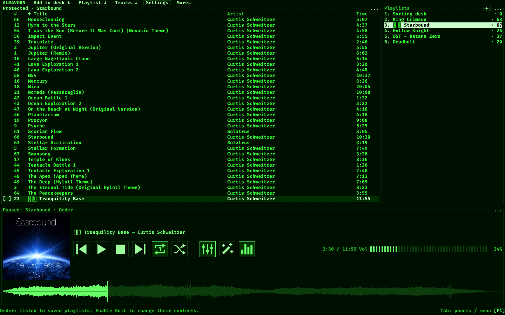
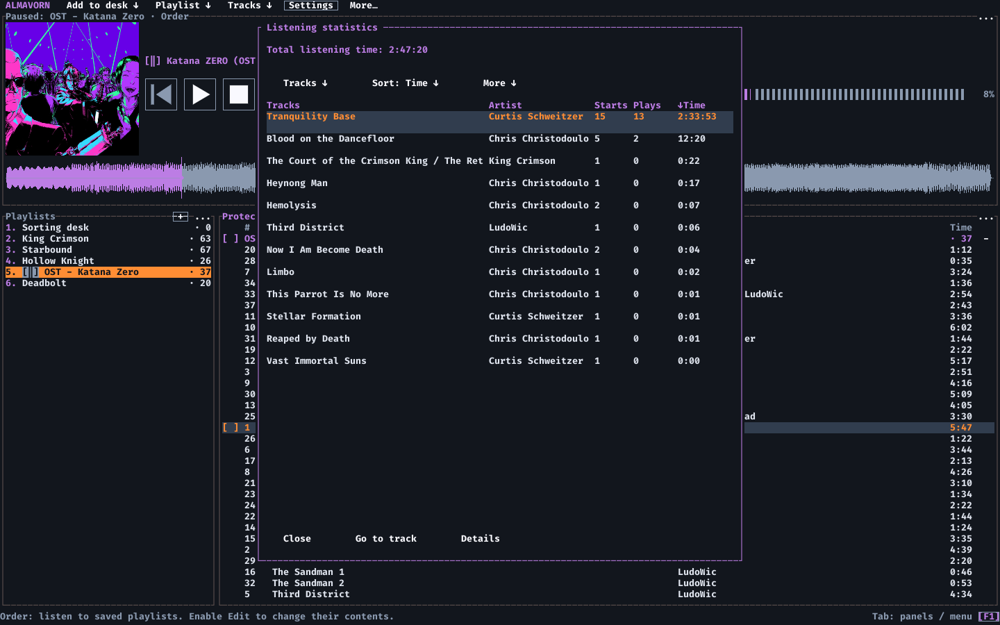
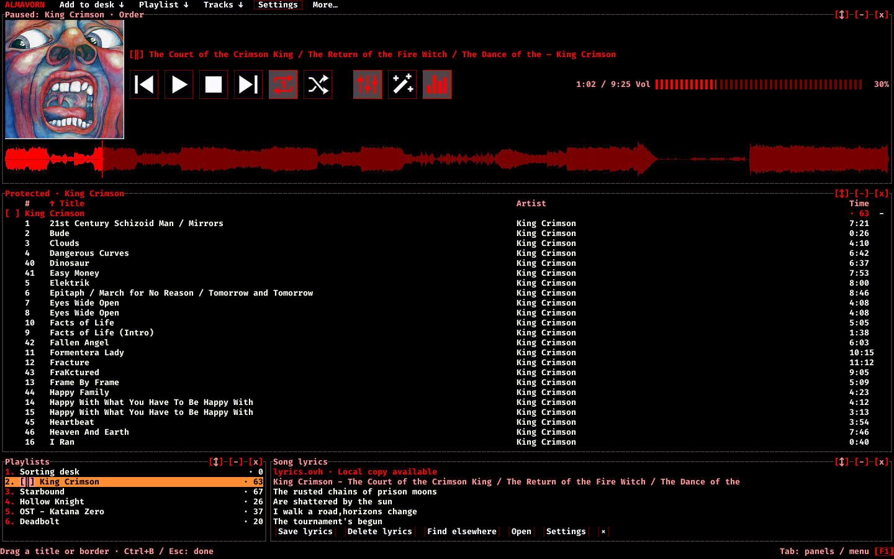
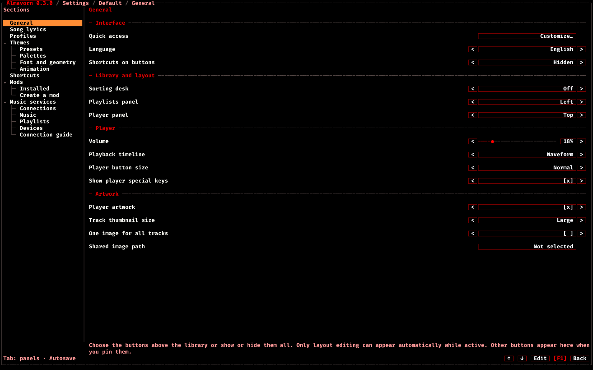
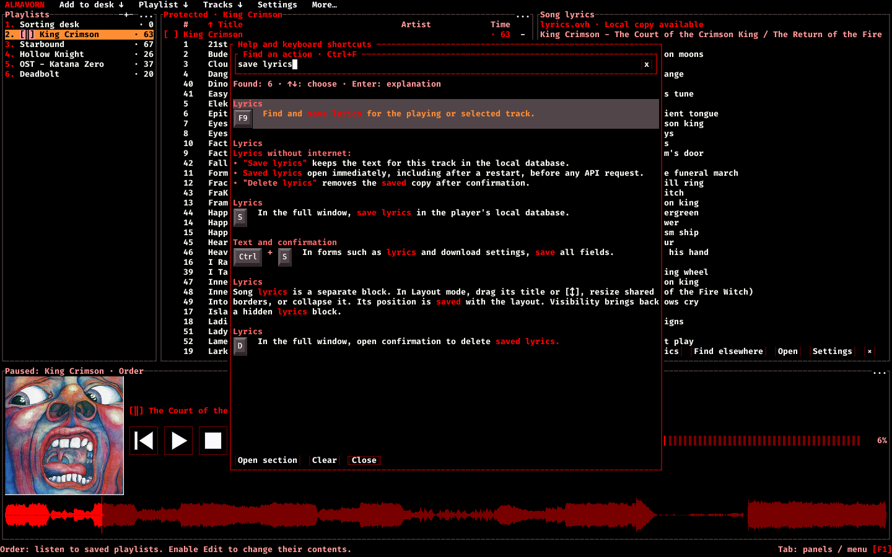
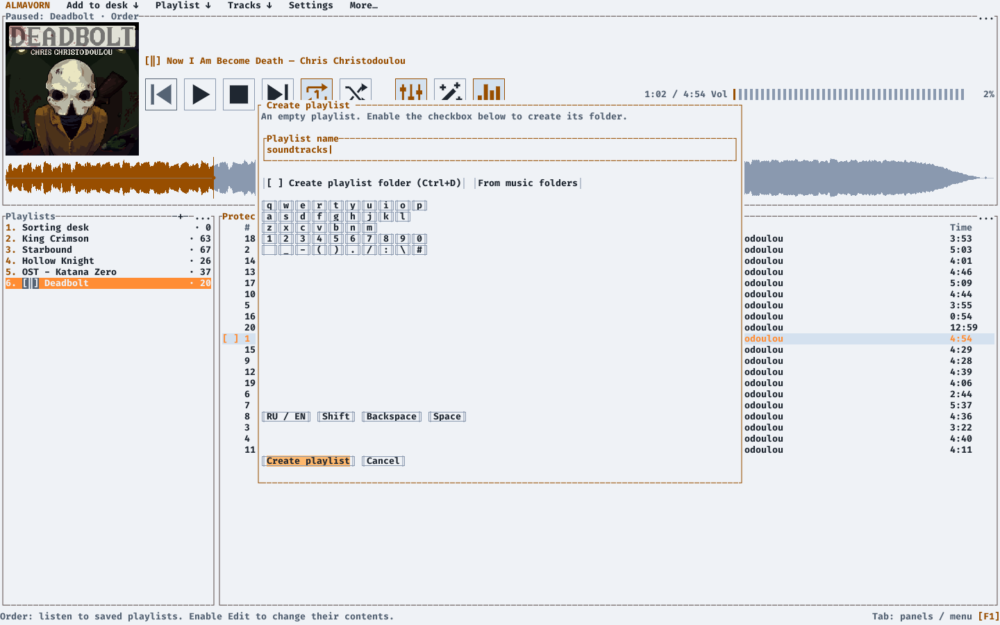
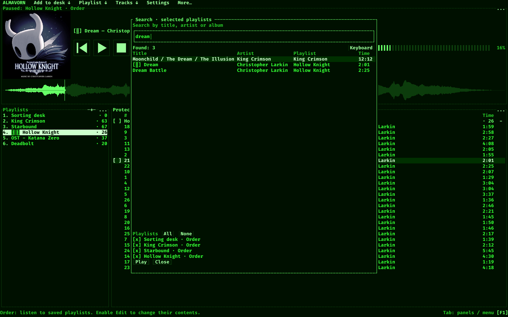
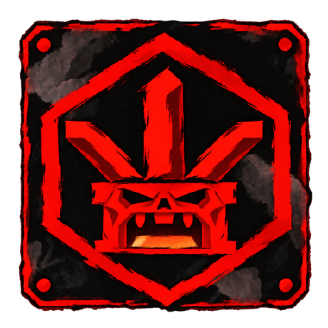

<p align="center">
  <picture>
    <source media="(prefers-color-scheme: light)" srcset="docs/images/almavorn-logo-light.png">
    
  </picture>
</p>

<h1 align="center">Almavorn</h1>

<p align="center">A music player for Linux, inspired by AIMP and Strawberry.<br><sub>Your music. Your shortcuts. Your layout.</sub></p>

<p align="center"><a href="README.md">English</a> · <a href="README.ru.md">Русский</a></p>

<p align="center"><a href="#install">Install</a> &nbsp; · &nbsp; <a href="#screenshots">Screenshots</a> &nbsp; · &nbsp; <a href="#first-launch">Getting&nbsp;started</a> &nbsp; · &nbsp; <a href="#help">Contribute</a></p>

<p align="center">
  <a href="docs/images/almavorn-lyrics-panel-en.png"></a>
  <br>
  <sub>King Crimson, The Court of the Crimson King: lyrics found through lyrics.ovh and saved for offline reading, alongside the track list and playlists.</sub>
</p>

<p align="center"></p>

**Almavorn** is built for comfort and control:

- Use your keyboard, your mouse, or both at once!
- An equalizer, playback settings, and background animations!
- Tooltips, action descriptions, and customizable shortcut highlighting!
- Remap keys, move panels, choose your own colors, and edit track titles and metadata.
  **It's all built in!**
- Two modes: **Order** protects playlists from accidental edits.
  Switch to **Chaos** to add tracks straight to playlists and folders!
- The **GUITUI** approach brings terminal and graphical interfaces together. Text panels and keyboard shortcuts form the foundation. A graphics layer adds cover art, waveforms, animations, and large mouse-operated buttons. Text and graphics share one window, while graphical elements can extend beyond the character grid.

Suggestions and feedback are welcome. We're only getting started, and we hope you'll enjoy the player!

##  Order, Chaos, and the sorting desk: what's the difference?

- **Order: "my collection, kept intact".** Playlists are protected from accidental changes. Choose "Edit" to make changes, then "Done" to lock the playlist again. Sorting the view preserves the saved track order.
- **The sorting desk is a key part of Order.** It's a shared playlist available in both modes: add files, correct titles, tags, and artwork, then copy tracks into the playlists you want!
- **Chaos: free-form playlists.** Rearrange tracks and build new playlists from existing ones. History keeps the last 100 actions until you close the player, so you can undo and redo them.

The tag editor writes changes to the audio file itself. Those changes affect that file in every playlist.

##  What else?

<details>
<summary>Some Features</summary>

- Find your music with search, filters, and sorting.
- Build playlists yourself or from folders, with or without subfolders.
- Drag playlists into order and combine them into new mixes!
- Use "Add new files" to find new tracks in linked folders.
- Listening statistics for every track! Double-click an entry to find that song in its playlist.
- Tune your sound with an equalizer and ten presets to choose from.
- Play tracks in reverse, adjust speed, tempo, pitch, and bass, and save different settings for every track!
  (now you can turn your track into that version from a hardstyle mix)
- Control playback with media keys while the window is minimized. Set global shortcuts in Settings.
- Choose themes, waveform styles, background animations, and settings profiles with your own shortcuts.
- Arrange blocks your way: drag their titles, resize them, and hide what you don't need!
- Read lyrics in the player and save them for offline listening.
- Edit titles, tags, and artwork for several tracks at once.
- Choose a cover thumbnail size and open the original with one click.
- Drag files straight from your file manager into the GUITUI window.
- Find and download music by name or link through "Downloads".
- Connect music services and listen online in the same window!
- Open keyboard help while your music keeps playing.
- Type with the on-screen keyboard and control the player with your mouse!
  (you can lie back with your head on a pillow and control everything with one hand)
- Mark just the tracks you want in a playlist and listen only to those!

</details>

<a id="screenshots"></a>

##  See the player in action

<p align="center">
  <a href="docs/images/almavorn-green-layout-en.png"></a>
  <br>
  <sub>The Green theme with a custom layout: playlists on the right, the player below the Starbound track list.</sub>
</p>

<p align="center">
  <a href="docs/images/almavorn-listening-statistics-en.png"></a>
  <br>
  <sub>Listening statistics: time played, starts and play counts for each track.</sub>
</p>

<p align="center">
  <a href="docs/images/almavorn-layout-editor-en.png"></a>
  <br>
  <sub>The layout editor: a compact arrangement with playlists and lyrics below the track list.</sub>
</p>

<p align="center">
  <a href="docs/images/almavorn-settings-general-en.png"></a>
  <br>
  <sub>Player settings: controls, artwork and panel placement. Themes, shortcuts, mods and services have their own sections on the left.</sub>
</p>

<p align="center">
  <a href="docs/images/almavorn-help-search-en.png"></a>
  <br>
  <sub>Help search highlights matches for "save lyrics" and shows the relevant actions with your shortcuts.</sub>
</p>

<p align="center">
  <a href="docs/images/almavorn-new-playlist-en.png"></a>
  <br>
  <sub>Creating a playlist in the Light theme: name, music folders, and an on-screen keyboard.</sub>
</p>

<p align="center">
  <a href="docs/images/almavorn-playlist-search-en.png"></a>
  <br>
  <sub>Search selected playlists: "dream" finds three tracks in Hollow Knight and King Crimson.</sub>
</p>

<a id="layout"></a>

##  Themes, appearance, and usability

Choose a GIF background under F2, "Themes", "Animation", "Background GIF". "Background visibility" ranges from 0 to 30%, with 15% as the default. Text and buttons stay opaque. Create or update a theme preset to save the file and its visibility. "Remove background GIF" turns it off without deleting the file.

<details>
<summary>How to move, resize and hide panels</summary>

"Layout" mode lets you rearrange the interface. For example, you can put the player at the bottom, playlists on the right, and give most of the window to the track list.

Choose "Edit layout" in "More", or press Ctrl+B. Controls will appear on the panel headers:

- "[↕]" lets you drag a block. You can also drag its title.
- "[-]" collapses a block, and "[+]" expands it again.
- "[x]" hides a block.

Where you drop a block determines what happens: drop it at the edge of another panel to place it beside that panel, or in the center to swap them. Drag the shared border between panels to resize them.

"Show blocks/buttons" in the "More" menu opens the list of blocks and buttons. You can bring back a hidden panel or hide individual buttons you don't need. "Restore default layout" is there too.

You can also use the keyboard: select a block with Tab, then use Ctrl+Alt+arrow keys to swap it with a neighboring block, or Ctrl+Shift+arrow keys to resize it. Ctrl+Alt+Space collapses or expands the block. Ctrl+Alt+Delete hides it.

Your layout is saved automatically. Press Ctrl+B or click "Edit layout" again to finish. During a drag, Esc cancels that move. Otherwise, it exits layout mode.

</details>

<a id="install"></a>

##  Download and install

The packaged release is **0.3.0**, for 64-bit Linux on Intel/AMD.

*(Windows support is in the works, hehe)* A reminder: **GUITUI** adds a graphics layer to the player's text interface in its own window. **TUI** runs directly in your terminal. Both versions share the music library, settings, and controls.

### GUITUI version

**GUITUI** runs in its own window with mouse and keyboard controls:

[AppImage](https://github.com/Molten-Zharr/Almavorn/releases/download/v0.3.0/almavorn-0.3.0-guitui-linux-x86_64.AppImage) - [Flatpak](https://github.com/Molten-Zharr/Almavorn/releases/download/v0.3.0/almavorn-0.3.0-guitui-linux-x86_64.flatpak) - [tar.gz](https://github.com/Molten-Zharr/Almavorn/releases/download/v0.3.0/almavorn-0.3.0-guitui-linux-x86_64.tar.gz) - especially handy on KDE/GNOME/COSMIC

---OR---

<a id="curl"></a>

```sh
curl -fsSL https://raw.githubusercontent.com/Molten-Zharr/Almavorn/main/install.sh | bash -s -- --variant guitui
```

### TUI version

**TUI** runs right inside your favorite terminal:

[AppImage](https://github.com/Molten-Zharr/Almavorn/releases/download/v0.3.0/almavorn-0.3.0-tui-linux-x86_64.AppImage) - [Flatpak](https://github.com/Molten-Zharr/Almavorn/releases/download/v0.3.0/almavorn-0.3.0-tui-linux-x86_64.flatpak) - [tar.gz](https://github.com/Molten-Zharr/Almavorn/releases/download/v0.3.0/almavorn-0.3.0-tui-linux-x86_64.tar.gz)

---OR---

```sh
curl -fsSL https://raw.githubusercontent.com/Molten-Zharr/Almavorn/main/install.sh | bash -s -- --variant tui
```

---

*- Psst, which one should I pick?*

*- Here's the difference:*

**curl** downloads and runs the installer from our repository for your chosen interface!
Paste the command straight into your terminal.

<a id="appimage"></a>

**AppImage** is a single file you can run without installing. [GUITUI](https://github.com/Molten-Zharr/Almavorn/releases/download/v0.3.0/almavorn-0.3.0-guitui-linux-x86_64.AppImage) · [TUI](https://github.com/Molten-Zharr/Almavorn/releases/download/v0.3.0/almavorn-0.3.0-tui-linux-x86_64.AppImage).

<a id="flatpak"></a>

**Flatpak** installs the app with its required components. [GUITUI](https://github.com/Molten-Zharr/Almavorn/releases/download/v0.3.0/almavorn-0.3.0-guitui-linux-x86_64.flatpak) · [TUI](https://github.com/Molten-Zharr/Almavorn/releases/download/v0.3.0/almavorn-0.3.0-tui-linux-x86_64.flatpak).

**tar.gz** is an archive with an installer and an application menu shortcut.

**How to update:** If you installed the player with the command above, run it again. Otherwise, download the same type of file you chose originally.

<a id="first-launch"></a>

##  First launch

F2 opens Settings. F1 opens the full help guide.

In Settings, hover over an option and press F1 to read its description without changing the value. If you use the keyboard, F1 explains the selected option.

Choose your toolbar buttons in "Settings > General > Quick access". Pin the buttons you need, or show or hide them all. Your choices are saved in the profile.

Other commands stay in "More", which opens with Alt+5 by default. When all buttons are on the toolbar and fit, "More" disappears.

Only the layout editing button appears automatically while that mode is active. Playback controls appear on the toolbar only when you pin them.

Shortcut labels on buttons are hidden by default. The shortcuts still work. To show labels, press F2 and open "General", then "Shortcuts on buttons".

Choose compact, normal or large under "Player button size" in the same section. Normal is the default. The square buttons and their icons grow together, with shortcut labels below.

In Statistics, choose a category and sorting from the drop-down lists. You can also click a column heading to sort, then click it again to reverse the order.

Open "More" for overall totals, details about the selected row and an explanation of how plays are counted.

Search Help in your own words: "make it louder", "recover a deleted song" or "move a panel". Search works offline and recognizes synonyms, word endings and small typos.

Results highlight matching words and show your current shortcuts. Press Enter to open the explanation. Button names stand out in color, and longer instructions are split into steps.

Complete matches come first. If none are found, Help shows partial matches.

### Create a playlist from a folder

1. At the top, open "Add to desk" and choose "Folders to playlists".
2. Find your music folder. Double-click or press Enter to open a folder. "Parent" takes you up one level. The current path appears at the top of the window, for example "/home/anna/Music".
3. Check the box next to a folder, or select it and press Insert. You can mark several folders at once: each becomes its own playlist!
4. Enable "Subfolders as groups" to include music from nested folders. Without it, only files directly inside the marked folders are added.
5. Click "Create playlists" or press Ctrl+Enter. The playlists will appear in the list, named after the folders you selected.
6. Open a playlist and double-click a track, or select it and press Enter. Space pauses and resumes playback.

### Build a playlist yourself

1. Open "Playlist" and choose "New playlist", or press C. Enter a name and press Enter to create an empty playlist.
2. Open "Add to desk", choose "Add files", mark the files you want, and click "Add to desk" at the bottom. For a whole folder, choose "Add folder", open that folder, then click "Current folder · Add to desk".
3. On the sorting desk, mark tracks using their checkboxes or Insert. Press X, choose your playlist, and click "Next: review copy".
4. Check the source, destination, and track list, then click "Confirm copying". Existing tracks are skipped, audio files stay in place, and a protected playlist remains protected.
5. To change the playlist contents or order later, enable editing. "Done", E again, or Esc finishes editing. Esc first closes an open window or cancels a drag.

The sorting desk helps you organize music before adding it to permanent playlists. In Chaos, you can add files straight to the open playlist: uncheck "Add to sorting desk" in the add menu.

### Other useful controls

- Ctrl+click the title in the player to copy "Artist - Title".
- F4 opens the equalizer, and F5 opens speed, tempo, and pitch settings.
- F7 opens statistics, F8 the tag editor, and F9 song lyrics.
- Use / to search playlists and Ctrl+F to filter the current playlist.
- Ctrl+B enables layout editing. Drag a block by its title, drag a border to resize it, then click "Done".
- Insert marks tracks, Ctrl+Enter plays only the marked tracks, and Ctrl+U returns to the whole playlist.
- In Chaos and on the sorting desk, Ctrl+Z undoes an action and Ctrl+Y redoes it.
- Tab switches panels, and right-click opens the action menu.
- Esc closes the open window. In the file picker, it clears the filter first.

These are the default keys. Set your own shortcuts under F2, "Shortcuts".

<a id="help"></a>

## Help build Almavorn

**ATTENTION!** External music services and account login are still being tested. We need help integrating Spotify, Yandex Music, and YouTube Music.

- Mods: create extensions, share examples, and help improve the mod system. [Getting started](docs/MODS.md).
- Themes: help expand the design options with custom frames, new control shapes, animations, and 2D or 3D graphics. Share your mockups and implementation ideas!
- Integrations: help Almavorn work with other window managers, panels, widgets, and music control tools.
- Testing: try TUI and GUITUI on other distributions, in different terminals, window managers, and desktop environments. We especially need feedback on installation, audio, display, and keyboard shortcuts.

Share ideas and test results in [Issues](https://github.com/Molten-Zharr/Almavorn/issues), and send code changes as pull requests. For a bug report, include the player version, TUI or GUITUI, your distribution, window manager, and the steps that trigger the problem.

[All releases](https://github.com/Molten-Zharr/Almavorn/releases) · [Keyboard shortcuts](docs/GLOBAL_SHORTCUTS.md) · [MIT license](LICENSE)

<p align="center"></p>

<p align="center">
  <a href="https://github.com/Molten-Zharr"></a>
  <br>
  <a href="https://github.com/Molten-Zharr"><b>Molten-Zharr</b></a>
  <br>
  <sub>STYLE. USABILITY. COMFORT.<br>We create applications you WANT to use.</sub>
</p>
