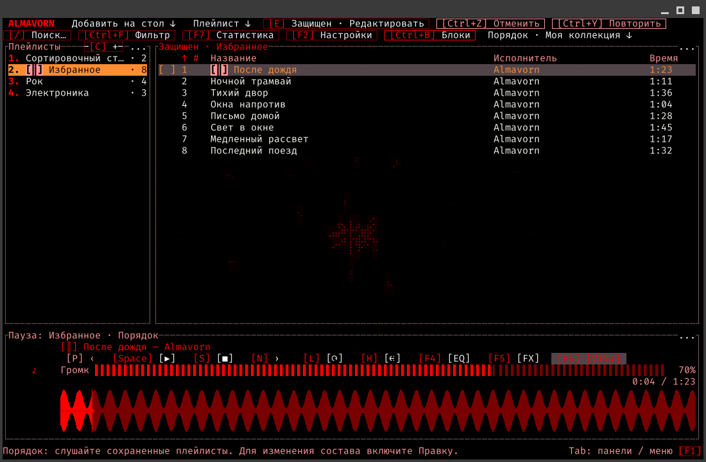
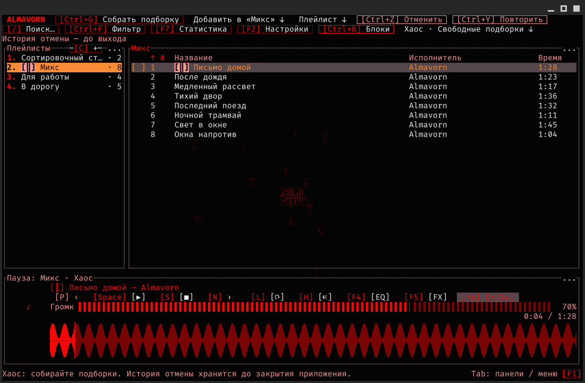

# Almavorn

[English](README.md) | [Русский](README.ru.md)

Музыкальный плеер для локального прослушивания на Linux, вдохновленный AIMP и Strawberry.

**Almavorn** создан, чтобы подарить максимум удобства и функциональности:
- Управляйте плеером с клавиатуры, с мыши, или с обоих устройств одновременно!
- Эквалайзер, настройки проигрывания, анимации фона!
- Подсказки, описание действий и произвольная подсветка горячих клавиш!
- Переназначить клавиши? Поменять положение панелей? Разукрасить палитру в свои цвета? Редактировать мета-данные трека и его название? **Все это возможно в нашем плеере из коробки!**
- Два режима работы: Хотите осторожные, защищенные от редактирования плейлисты? Режим "**Порядка**" тут. 
  Желаете добавлять треки сразу в плейлисты и папки? Переключаемся на режим "**Хаоса**"!

Мы открыты к предложениям и обратной связи. Мы только начали разгоняться, поэтому надеемся, что вам понравится наш плеер!



## Порядок, Хаос, сортировочный стол - что это?

- **Порядок - моя неделимая коллекция.** Плейлисты защищены от случайных изменений, а для правок нужно нажать "Редактировать", и после - "Готово". Сортировка на экране не меняет сохраненный порядок композиций.
- **Сортировочный стол - важная часть режима "Порядка"**. Это общий плейлист для обоих режимов: здесь мы добавляем файлы, поправляем названия, теги и обложки, а затем перемещаем композиции в нужные плейлисты!
- **Хаос - свободные плейлисты.** Вы меняете порядок композиций и собираете новые плейлисты из существующих. История хранит последние 100 действий до закрытия плеера: их можно отменять и повторять.

Редактор тегов сохраняет изменения в сам аудиофайл. Они затрагивают этот файл во всех плейлистах.



## А что еще?

- Находите музыку поиском, фильтрами и сортировкой плейлистов.
- Создавайте плейлисты из сами, автоматически из папки, включая или исключая вложенные папки.
- Статистика прослушивания по каждому треку! И вы можете сразу включить ваш любимый трек отсюда же!
- Настраивайте звучание эквалайзером - десяток различных пресетов на любой вкус.
- Перемотка назад, повышение скорости, темпа и тональности с басами. Так еще и сохранение для каждого трека уникально!
  (теперь вы точно сможете превратить ваш трек в тот самый из hardstyle подборки)
- Управляйте музыкой медиаклавишами, даже когда окно свернуто. Глобальные клавиши задаются в настройках.
- Выбирайте темы, стили аудиоволны, анимации фона, профиля настроек с вашими клавишами.
- Открывайте подсказки по клавишам прямо во время прослушивания.
- Экранная клавиатура для набора текста мышью и куча манипуляций через мышь!
  (можно лежать, уткнувшись в подушку, и настраивать все одной рукой)

## Хочу скачать и установить! Что есть?

Готовый выпуск — **0.1.4**, для 64-разрядного Linux на Intel/AMD.

*(для Windows пока в работе, хе-хе)*

### GUITUI версия

**GUITUI** — отдельное окно с управлением мышью и клавиатурой:

[AppImage](https://github.com/Molten-Zharr/Almavorn/releases/download/v0.1.4/almavorn-0.1.4-guitui-linux-x86_64.AppImage) - [Flatpak](https://github.com/Molten-Zharr/Almavorn/releases/download/v0.1.4/almavorn-0.1.4-guitui-linux-x86_64.flatpak) - [tar.gz](https://github.com/Molten-Zharr/Almavorn/releases/download/v0.1.4/almavorn-0.1.4-guitui-linux-x86_64.tar.gz) - особенно удобно для KDE/Gnome/Cosmic

---ИЛИ---

```sh
curl -fsSL https://raw.githubusercontent.com/Molten-Zharr/Almavorn/main/install.sh | bash -s -- --variant guitui
```

### TUI версия

**TUI** — интерфейс прямо в вашем любимом терминале: 

[AppImage](https://github.com/Molten-Zharr/Almavorn/releases/download/v0.1.4/almavorn-0.1.4-tui-linux-x86_64.AppImage) - [Flatpak](https://github.com/Molten-Zharr/Almavorn/releases/download/v0.1.4/almavorn-0.1.4-tui-linux-x86_64.flatpak) - [tar.gz](https://github.com/Molten-Zharr/Almavorn/releases/download/v0.1.4/almavorn-0.1.4-tui-linux-x86_64.tar.gz) 

---ИЛИ---

```sh
curl -fsSL https://raw.githubusercontent.com/Molten-Zharr/Almavorn/main/install.sh | bash -s -- --variant tui
```

*- Псcc, хей, а что мне выбрать из этого?*

*- Смотри:*

**curl** - это прямая ссылка на скачивание и установку. Берет наш репозиторий и вариант плеера и устанавливает по скрипту! 
Вводи прямо в твою консольку.
**AppImage** — один файл для запуска без установки.
**Flatpak** — установка пакета вместе с нужными компонентами.
**tar.gz** — архив с установщиком и ярлыком в меню.

Для обновления скачайте тот же тип файла, что и раньше: AppImage, Flatpak или tar.gz. Если устанавливали плеер командой выше, повторите ее.

## Установка

- **Из исходников:** выполните команду своей версии выше. Для своей копии репозитория есть [инструкция по сборке](docs/RELEASE.md#установка-из-исходников).
- **tar.gz:** распакуйте архив, откройте терминал в полученной папке и выполните (нужен Python 3):

  ```sh
  python3 install.py
  ```

- **AppImage:** разрешите запуск в свойствах файла. GUITUI откройте двойным щелчком; файл TUI перетащите в терминал и нажмите Enter.
- **Flatpak:** откройте пакет в менеджере приложений и нажмите "Установить". Если Flatpak еще нет, [настройте его](https://flathub.org/en/setup).

После установки плеер появится в меню: "Almavorn" или "Almavorn TUI". [Подробности установки](docs/RELEASE.md#установка-готового-выпуска).

## Первый запуск

1. Нажмите "Добавить на стол" и выберите файлы или папку.
2. Выберите композицию и нажмите Space для воспроизведения.
3. Откройте настройки клавишей F2, а полную справку — F1.

Сортировочный стол поможет разобрать музыку перед добавлением в постоянные плейлисты.

## Обновление

Закройте работающий плеер и обновите **тот же интерфейс тем же способом**:

- **tar.gz:** распакуйте новый архив и запустите его "install.py".
- **AppImage:** скачайте новый файл, разрешите запуск и открывайте его.
- **Flatpak:** скачайте новый пакет из [выпусков](https://github.com/Molten-Zharr/Almavorn/releases) и повторите команду установки с его именем.
- **Сборка из исходников:** повторите свою команду установки.

[Все выпуски](https://github.com/Molten-Zharr/Almavorn/releases) · [Горячие клавиши](docs/GLOBAL_SHORTCUTS.md) · [Лицензия MIT](LICENSE)
