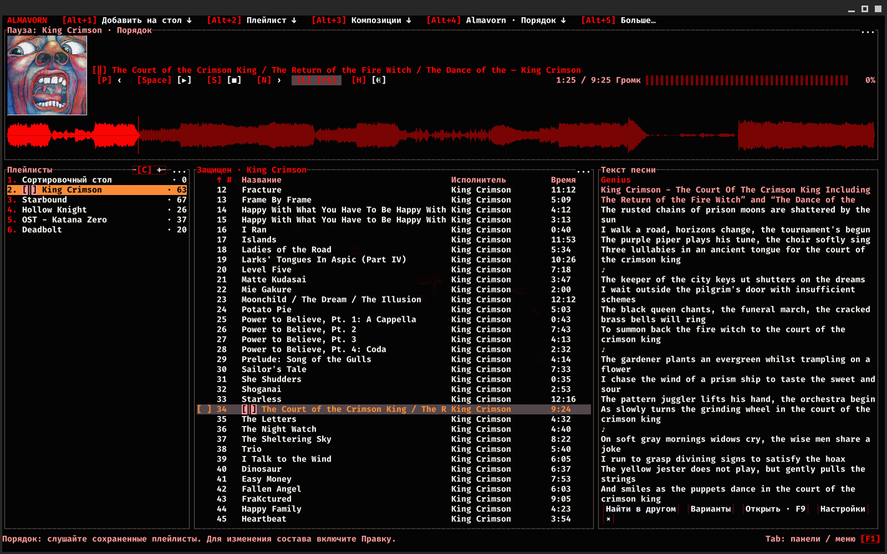
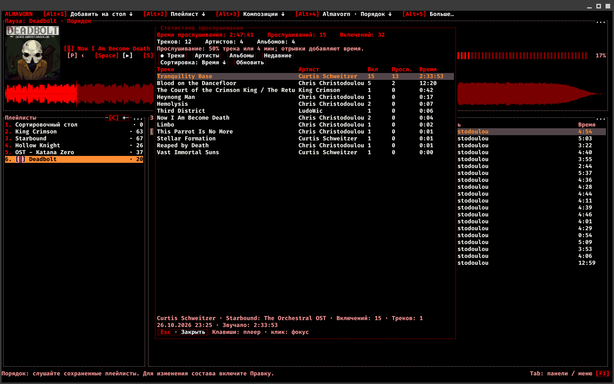
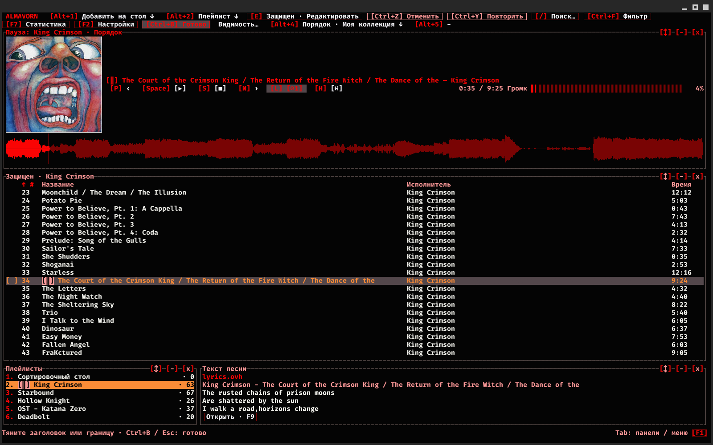
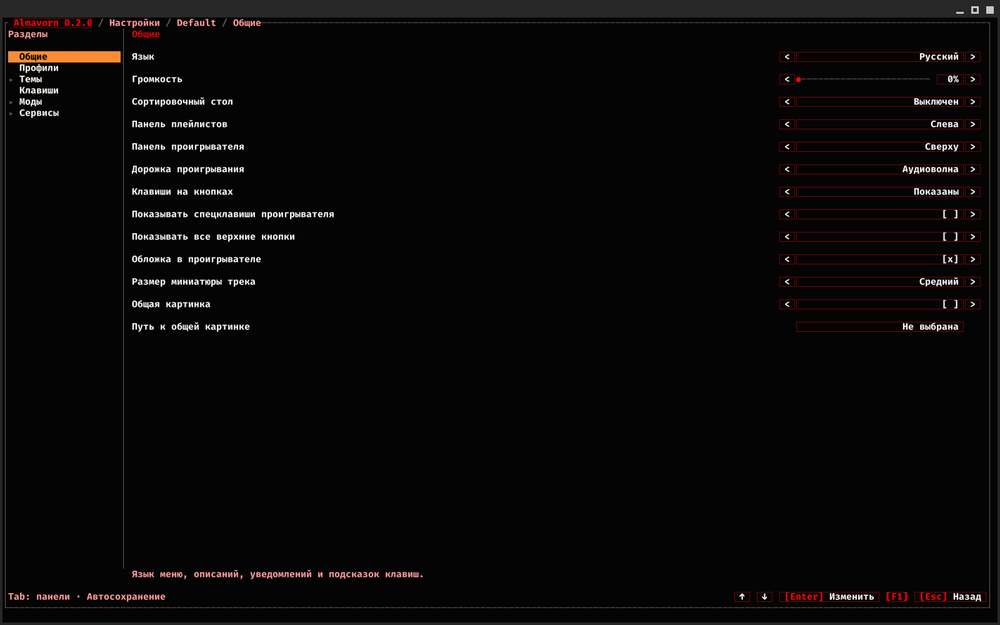
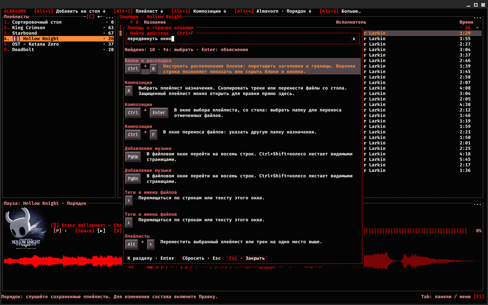
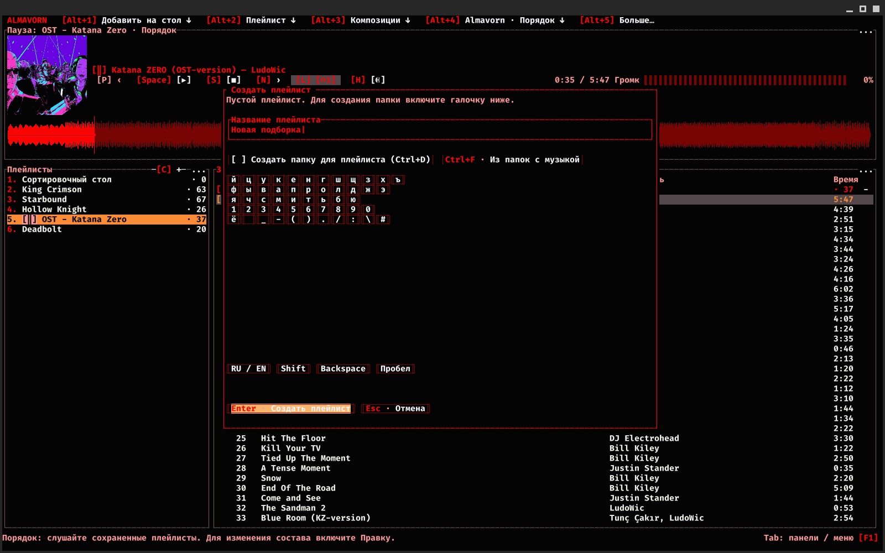
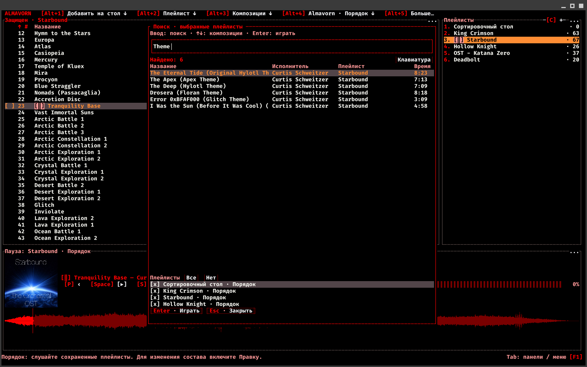

<p align="center">
  <picture>
    <source media="(prefers-color-scheme: light)" srcset="docs/images/almavorn-logo-light.png">
    
  </picture>
</p>

<h1 align="center">Almavorn</h1>

<p align="center">Музыкальный плеер для Linux, вдохновленный AIMP и Strawberry.<br><sub>Своя музыка. Свои клавиши. Свое расположение блоков.</sub></p>

<p align="center"><a href="README.md">English</a> · <a href="README.ru.md">Русский</a></p>

<p align="center"><a href="#install"> Установить</a> &nbsp; · &nbsp; <a href="#screenshots"> Скриншоты</a> &nbsp; · &nbsp; <a href="#first-launch"> Первый запуск</a></p>

<p align="center">
  <a href="docs/images/almavorn-lyrics.png"></a>
  <br>
  <sub>King Crimson, The Court of the Crimson King: текст найден в Genius и открыт рядом с композицией и плейлистами.</sub>
</p>

<p align="center"></p>

**Almavorn** создан, чтобы подарить максимум удобства и функциональности:

- Управляйте плеером с клавиатуры, с мыши, или с обоих устройств одновременно!
- Эквалайзер, настройки проигрывания, анимации фона!
- Подсказки, описание действий и произвольная подсветка горячих клавиш!
- Переназначить клавиши? Поменять положение панелей? Разукрасить палитру в свои цвета? Редактировать мета-данные трека и его название?
  **Все это возможно в нашем плеере из коробки!**
- Два режима работы: Хотите осторожные, защищенные от редактирования плейлисты? Режим "**Порядка**" тут.
  Желаете добавлять треки сразу в плейлисты и папки? Переключаемся на режим "**Хаоса**"!

Мы открыты к предложениям и обратной связи. Мы только начали разгоняться, поэтому надеемся, что вам понравится наш плеер!

##  Порядок, Хаос, сортировочный стол - что это?

- **Порядок - "моя неделимая коллекция".** Плейлисты защищены от случайных изменений, а для правок нужно нажать "Редактировать", и после - "Готово". Сортировка на экране не меняет сохраненный порядок композиций.
- **Сортировочный стол - важная часть режима "Порядка"**. Это общий плейлист для обоих режимов: здесь мы добавляем файлы, поправляем названия, теги и обложки, а затем перемещаем композиции в нужные плейлисты!
- **Хаос - свободные плейлисты.** Вы меняете порядок композиций и собираете новые плейлисты из существующих. История хранит последние 100 действий до закрытия плеера: их можно отменять и повторять.

Редактор тегов сохраняет изменения в сам аудиофайл. Они затрагивают этот файл во всех плейлистах.

##  А что еще?

- Находите музыку поиском, фильтрами и сортировкой плейлистов.
- Создавайте плейлисты сами или из папок - с подпапками или без них.
- Перетаскивайте плейлисты мышью и собирайте из них новые подборки!
- Пополняйте плейлисты кнопкой "Добавить новые" - плеер проверит связанные папки.
- Статистика прослушивания по каждому треку! Двойной клик вернет вас к любимой композиции в плейлисте.
- Настраивайте звучание эквалайзером - десяток различных пресетов на любой вкус.
- Перемотка назад, повышение скорости, темпа и тональности с басами. Так еще и сохранение для каждого трека уникально!
  (теперь вы точно сможете превратить ваш трек в тот самый из hardstyle подборки)
- Управляйте музыкой медиаклавишами, даже когда окно свернуто. Глобальные клавиши задаются в настройках.
- Выбирайте темы, стили аудиоволны, анимации фона, профили настроек с вашими клавишами.
- Расставляйте блоки по-своему: тяните за заголовки, меняйте размеры, скрывайте лишнее!
- Читайте тексты песен прямо в плеере и сохраняйте их для прослушивания без интернета.
- Правьте названия, теги и обложки сразу у нескольких треков.
- Выбирайте размер миниатюры обложки, а оригинал открывайте одним кликом.
- Перетаскивайте файлы из вашей папки прямо в окно GUITUI.
- Ищите и скачивайте музыку по названию или ссылке через "Загрузки".
- Подключайте музыкальные сервисы и слушайте онлайн в том же окне!
- Открывайте подсказки по клавишам прямо во время прослушивания.
- Экранная клавиатура для набора текста мышью и куча манипуляций через мышь!
  (можно лежать, уткнувшись в подушку, и настраивать все одной рукой)
- Внутри плейлиста вы можете отметить конкретные композиции - и прослушивать только их!

<a id="screenshots"></a>

##  Плеер в действии

<p align="center">
  <a href="docs/images/almavorn-green.png"></a>
  <br>
  <sub>Тема Green и свое размещение: плейлисты справа, проигрыватель снизу, композиции Starbound сверху.</sub>
</p>

<p align="center">
  <a href="docs/images/almavorn-statistics.png"></a>
  <br>
  <sub>Статистика прослушивания: время, включения и прослушивания каждой композиции.</sub>
</p>

<p align="center">
  <a href="docs/images/almavorn-layout.png"></a>
  <br>
  <sub>Редактор блоков: пример компактной компоновки с плейлистами и текстом песни под списком композиций.</sub>
</p>

<p align="center">
  <a href="docs/images/almavorn-settings.png"></a>
  <br>
  <sub>Настройки плеера: управление, обложки и расположение панелей. Темы, клавиши, моды и сервисы доступны в разделах слева.</sub>
</p>

<p align="center">
  <a href="docs/images/almavorn-help.png"></a>
  <br>
  <sub>Поиск в помощи своими словами: запрос "передвинуть окно" находит настройку блоков и показывает ваши горячие клавиши.</sub>
</p>

<p align="center">
  <a href="docs/images/almavorn-create-playlist.png"></a>
  <br>
  <sub>Создание плейлиста: задайте название, создайте новую папку или выберите существующие папки с музыкой.</sub>
</p>

<p align="center">
  <a href="docs/images/almavorn-search.png"></a>
  <br>
  <sub>Поиск композиций по выбранным плейлистам: шесть совпадений по запросу "Theme" в Starbound.</sub>
</p>

<a id="layout"></a>

##  Темы, оформление и удобство

<details>
<summary>Как двигать, менять размер и скрывать блоки</summary>

"Блоки" - режим настройки расположения интерфейса. Например, можно поставить проигрыватель снизу, плейлисты справа, а списку композиций отдать большую часть окна.

Нажмите "Блоки" или Ctrl+B. На заголовках панелей появятся кнопки управления:

- "[↕]" - перетаскивание. Можно тянуть и за сам заголовок.
- "[-]" - свернуть блок; "[+]" - развернуть обратно.
- "[x]" - скрыть блок.

При перетаскивании место, куда вы отпускаете блок, определяет результат: у края другой панели он встанет рядом с ней, а в центре - поменяется с ней местами. Чтобы изменить размеры соседних панелей, потяните их общую границу.

Кнопка "Видимость…" открывает список блоков и кнопок. Здесь можно вернуть скрытую панель или убрать отдельные ненужные кнопки. Там же есть "Вернуть исходную раскладку".

С клавиатуры тоже можно: выберите блок через Tab, затем используйте Ctrl+Alt+стрелки для перестановки с соседним блоком или Ctrl+Shift+стрелки для изменения размера. Ctrl+Alt+Space сворачивает блок, Ctrl+Alt+Delete скрывает его.

Раскладка сохраняется автоматически. Нажмите "Готово" или Ctrl+B, чтобы закончить. Esc во время перетаскивания отменяет текущий перенос; вне перетаскивания - выходит из режима.

</details>

<a id="install"></a>

##  Хочу скачать и установить! Что есть?

Готовый выпуск - **0.2.0**, для 64-разрядного Linux на Intel/AMD.

*(для Windows пока в работе, хе-хе)*

### GUITUI версия

**GUITUI** - отдельное окно с управлением мышью и клавиатурой:

[AppImage](https://github.com/Molten-Zharr/Almavorn/releases/download/v0.2.0/almavorn-0.2.0-guitui-linux-x86_64.AppImage) - [Flatpak](https://github.com/Molten-Zharr/Almavorn/releases/download/v0.2.0/almavorn-0.2.0-guitui-linux-x86_64.flatpak) - [tar.gz](https://github.com/Molten-Zharr/Almavorn/releases/download/v0.2.0/almavorn-0.2.0-guitui-linux-x86_64.tar.gz) - особенно удобно для KDE/Gnome/Cosmic

---ИЛИ---

<a id="curl"></a>

```sh
curl -fsSL https://raw.githubusercontent.com/Molten-Zharr/Almavorn/main/install.sh | bash -s -- --variant guitui
```

### TUI версия

**TUI** - интерфейс прямо в вашем любимом терминале:

[AppImage](https://github.com/Molten-Zharr/Almavorn/releases/download/v0.2.0/almavorn-0.2.0-tui-linux-x86_64.AppImage) - [Flatpak](https://github.com/Molten-Zharr/Almavorn/releases/download/v0.2.0/almavorn-0.2.0-tui-linux-x86_64.flatpak) - [tar.gz](https://github.com/Molten-Zharr/Almavorn/releases/download/v0.2.0/almavorn-0.2.0-tui-linux-x86_64.tar.gz)

---ИЛИ---

```sh
curl -fsSL https://raw.githubusercontent.com/Molten-Zharr/Almavorn/main/install.sh | bash -s -- --variant tui
```


---

*- Псcc, хей, а что мне выбрать из этого?*

*- Смотри:*

**curl** - это прямая ссылка на скачивание и установку. Берет наш репозиторий и вариант плеера и устанавливает по скрипту!
Вводи прямо в твою консольку.

<a id="appimage"></a>

**AppImage** - один файл для запуска без установки. [GUITUI](https://github.com/Molten-Zharr/Almavorn/releases/download/v0.2.0/almavorn-0.2.0-guitui-linux-x86_64.AppImage) · [TUI](https://github.com/Molten-Zharr/Almavorn/releases/download/v0.2.0/almavorn-0.2.0-tui-linux-x86_64.AppImage).

<a id="flatpak"></a>

**Flatpak** - установка пакета вместе с нужными компонентами. [GUITUI](https://github.com/Molten-Zharr/Almavorn/releases/download/v0.2.0/almavorn-0.2.0-guitui-linux-x86_64.flatpak) · [TUI](https://github.com/Molten-Zharr/Almavorn/releases/download/v0.2.0/almavorn-0.2.0-tui-linux-x86_64.flatpak).

**tar.gz** - архив с установщиком и ярлыком в меню.

**Как обновиться:** Если устанавливали плеер командой выше, повторите ее, либо скачайте тот же тип файла, что вы скачивали изначально.

<a id="first-launch"></a>

##  Первый запуск

F2 открывает настройки, F1 - полную справку. В настройках F1 объясняет выбранный пункт.

В справке можно искать своими словами: "сделать громче", "вернуть удаленное", "передвинуть окно". Поиск работает без интернета, учитывает синонимы, окончания слов и небольшие опечатки. Результаты показывают клавиши из ваших настроек; Enter открывает нужное объяснение.

### Создаем плейлист из папки

1. Вверху нажмите "Добавить на стол" → "Папки в плейлисты".
2. Найдите папку с музыкой. Двойной клик или Enter открывает папку, кнопка "Выше" возвращает на уровень назад. Текущий путь виден вверху окна: например, "/home/anna/Музыка".
3. Поставьте галочку рядом с нужной папкой или выделите ее и нажмите Insert. Можно отметить сразу несколько папок - из каждой получится свой плейлист!
4. Включите "Подпапки в группы", если нужна музыка из вложенных папок. Без этой галочки добавятся только файлы из самих отмеченных папок.
5. Нажмите "Создать плейлисты" или Ctrl+Enter. Плейлисты появятся в списке с названиями выбранных папок.
6. Откройте плейлист и дважды кликните по треку или выберите его и нажмите Enter. Space ставит воспроизведение на паузу и продолжает его.

### Собираем плейлист сами

1. Откройте "Плейлист" → "Создать плейлист" или нажмите C. Введите название и нажмите Enter - готов пустой плейлист.
2. В режиме "Порядка" выберите его и нажмите "Редактировать".
3. Через "Добавить на стол" → "Добавить файлы" отметьте нужные файлы и нажмите "Добавить на стол" внизу окна. Для целой папки: "Добавить папку" → откройте нужную папку → "Текущая папка · Добавить на стол".
4. На сортировочном столе отметьте композиции галочками или Insert. Нажмите X, выберите свой плейлист и подтвердите Enter. Композиции скопируются в него; исходные файлы останутся на месте.
5. Вернитесь в плейлист и нажмите "Готово", чтобы снова защитить его от случайных изменений.

Сортировочный стол поможет разобрать музыку перед добавлением в постоянные плейлисты. В "Хаосе" можно добавлять файлы сразу в открытый плейлист: снимите галочку "Добавлять в сортировочный стол" в меню добавления.

### Что еще пригодится сразу

- F4 - эквалайзер, F5 - скорость, темп и тональность.
- F7 - статистика, F8 - редактор тегов, F9 - текст песни.
- / - поиск по плейлистам, Ctrl+F - фильтр текущего плейлиста.
- Ctrl+B - перестановка блоков. Перетащите блок за заголовок, потяните границу для изменения размера, затем нажмите "Готово".
- Insert отмечает треки, Ctrl+Enter запускает только отмеченные, Ctrl+U возвращает весь плейлист.
- Ctrl+Z отменяет действие, Ctrl+Y повторяет - в "Хаосе" и на сортировочном столе.
- Tab переключает панели, правый клик открывает меню действий. Esc закрывает открытое окно; в поиске файлов сначала очищает фильтр.

Это клавиши по умолчанию. Свои сочетания можно задать в F2 → "Клавиши".

[Все выпуски](https://github.com/Molten-Zharr/Almavorn/releases) · [Горячие клавиши](docs/GLOBAL_SHORTCUTS.md) · [Лицензия MIT](LICENSE)

<p align="center"></p>

<p align="center">
  <a href="https://github.com/Molten-Zharr"></a>
  <br>
  <a href="https://github.com/Molten-Zharr"><b>Molten-Zharr</b></a>
  <br>
  <sub>STYLE. USABILITY. COMFORT.<br>We create applications you WANT to use.</sub>
</p>
