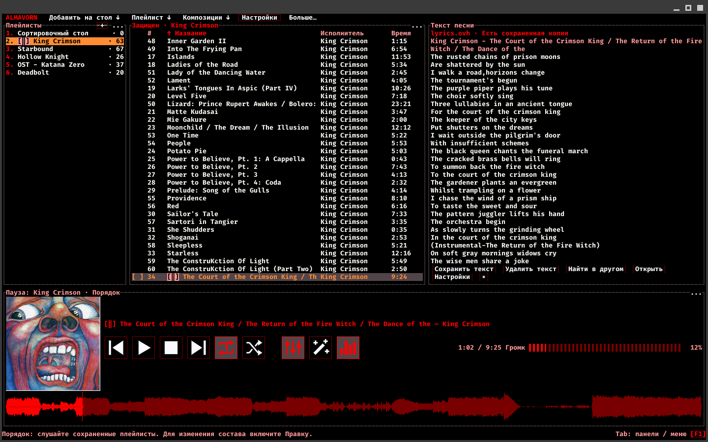
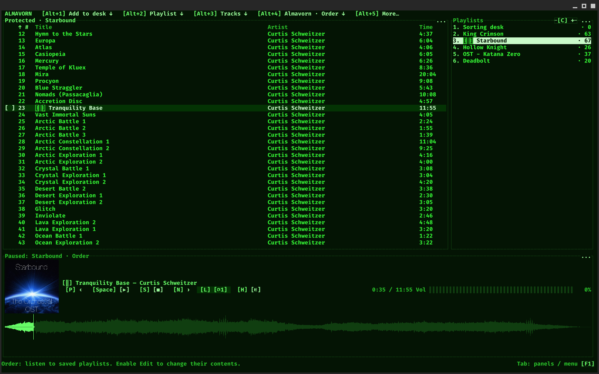
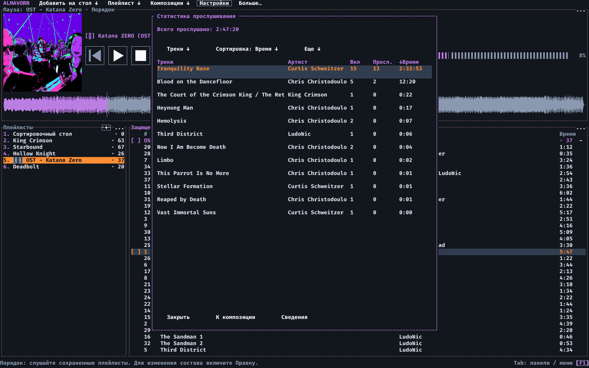
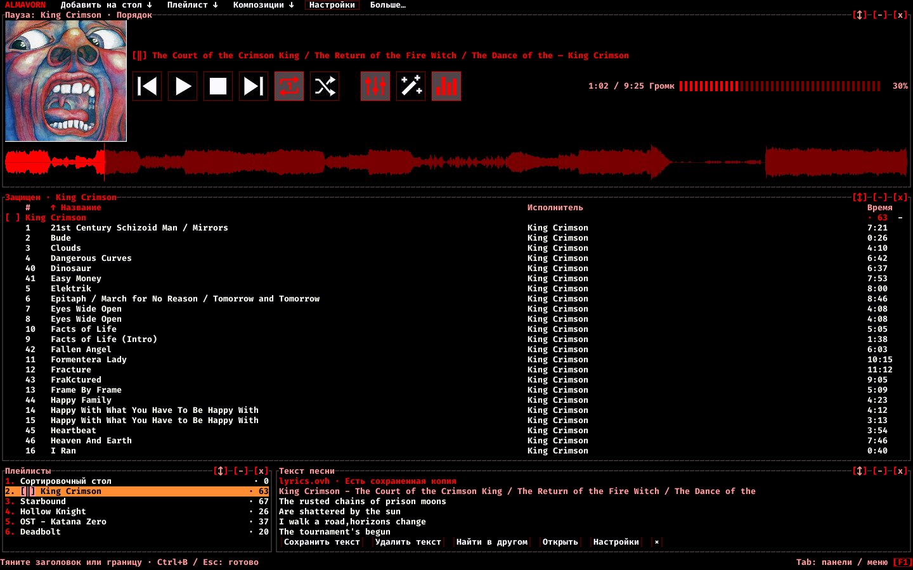
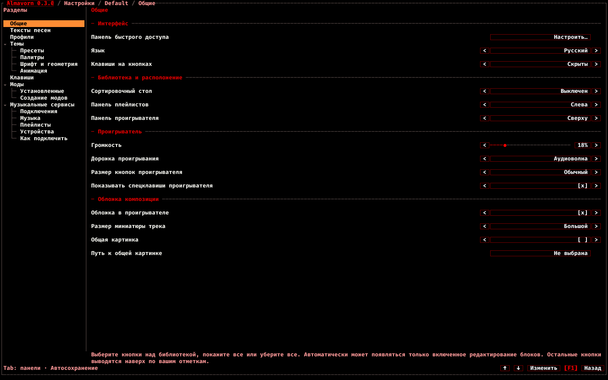
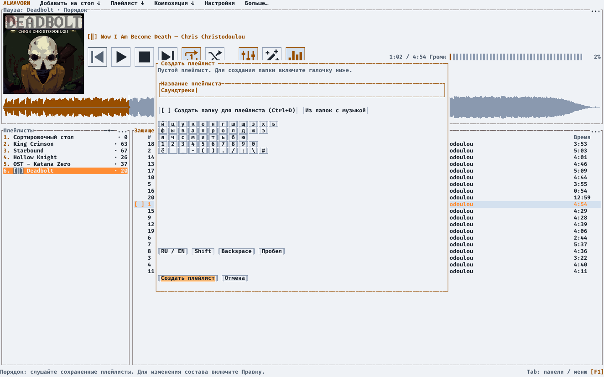

<p align="center">
  <picture>
    <source media="(prefers-color-scheme: light)" srcset="docs/images/almavorn-logo-light.png">
    
  </picture>
</p>

<h1 align="center">Almavorn</h1>

<p align="center">Музыкальный плеер для Linux, вдохновленный AIMP и Strawberry.<br><sub>Своя музыка. Свои клавиши. Свое расположение. Полный кастом.</sub></p>

<p align="center"><a href="README.md">English</a> · <a href="README.ru.md">Русский</a></p>

<p align="center"><a href="#install">Установить</a> &nbsp; · &nbsp; <a href="#screenshots">Скриншоты</a> &nbsp; · &nbsp; <a href="#first-launch">Первый&nbsp;запуск</a> &nbsp; · &nbsp; <a href="#help">Помочь&nbsp;проекту</a></p>

<p align="center">
   <a href="docs/images/almavorn-lyrics-panel.png"></a>
  <br>
  <sub>King Crimson, The Court of the Crimson King: текст найден через lyrics.ovh и сохранен для чтения без интернета. Рядом остаются композиции и плейлисты.</sub>
</p>

<p align="center"></p>

**Almavorn** создан, чтобы подарить максимум удобства и функциональности:

- Управляйте плеером с клавиатуры, с мыши, или с обоих устройств одновременно!
- Эквалайзер, настройки проигрывания, анимации фона!
- Подсказки, описание действий и произвольная подсветка горячих клавиш!
- Переназначить клавиши? Поменять положение панелей? Разукрасить палитру в свои цвета? Редактировать мета-данные трека и его название?
  **Все это возможно в нашем плеере из коробки!**
- Два режима работы: Хотите осторожные, защищенные от редактирования плейлисты? Режим "**Порядка**" тут.
  Желаете добавлять треки сразу в плейлисты и папки? Переключаемся на режим "**Хаоса**"!
- Кроме TUI, еще и техника **GUITUI** - объединение терминального и графического интерфейсов. В основе остается текстовый интерфейс с панелями и горячими клавишами, а графический слой добавляет обложки, аудиоволну, анимации и крупные кнопки с управлением мышью. Текст и графика работают вместе в отдельном окне, а графические элементы могут выходить за рамки символьной сетки.

Мы открыты к предложениям и обратной связи. Мы только начали разгоняться, поэтому надеемся, что вам понравится наш плеер!

##  Порядок, Хаос, сортировочный стол - что это?

- **Порядок - "моя неделимая коллекция".** Плейлисты защищены от случайных изменений, а для правок нужно нажать "Редактировать", и после - "Готово". Сортировка на экране не меняет сохраненный порядок композиций.
- **Сортировочный стол - важная часть режима "Порядка"**. Это общий плейлист для обоих режимов: здесь мы добавляем файлы, поправляем названия, теги и обложки, а затем перемещаем композиции в нужные плейлисты!
- **Хаос - свободные плейлисты.** Вы меняете порядок композиций и собираете новые плейлисты из существующих. История хранит последние 100 действий до закрытия плеера: их можно отменять и повторять.

Редактор тегов сохраняет изменения в сам аудиофайл. Они затрагивают этот файл во всех плейлистах.

##  А что еще?

<details>
<summary>Некоторые возможности</summary>

- Находите музыку поиском, фильтрами и сортировкой плейлистов.
- Создавайте плейлисты сами или из папок - с подпапками или без них.
- Перетаскивайте плейлисты мышью и собирайте из них новые подборки!
- Пополняйте плейлисты кнопкой "Добавить новые" - плеер проверит связанные папки.
- Статистика прослушивания по каждому треку! Двойной клик вернет вас к любимой композиции в плейлисте.
- Настраивайте звучание эквалайзером - десяток различных пресетов на любой вкус.
- Перемотка назад, повышение скорости, темпа и тональности с басами. Так еще и сохранение для каждого трека уникально!
  (теперь вы точно сможете превратить ваш трек в тот самый из hardstyle подборки)
- Управляйте музыкой медиаклавишами, даже когда окно свернуто. Глобальные клавиши задаются в настройках.
- Выбирайте темы, стили аудиоволны, анимации фона, профили настроек с вашими клавишами.
- Расставляйте блоки по-своему: тяните за заголовки, меняйте размеры, скрывайте лишнее!
- Читайте тексты песен прямо в плеере и сохраняйте их для прослушивания без интернета.
- Правьте названия, теги и обложки сразу у нескольких треков.
- Выбирайте размер миниатюры обложки, а оригинал открывайте одним кликом.
- Перетаскивайте файлы из вашей папки прямо в окно GUITUI.
- Ищите и скачивайте музыку по названию или ссылке через "Загрузки".
- Подключайте музыкальные сервисы и слушайте онлайн в том же окне!
- Открывайте подсказки по клавишам прямо во время прослушивания.
- Экранная клавиатура для набора текста мышью и куча манипуляций через мышь!
  (можно лежать, уткнувшись в подушку, и настраивать все одной рукой)
- Внутри плейлиста вы можете отметить конкретные композиции - и прослушивать только их!

</details>

<a id="screenshots"></a>

##  Плеер в действии

<p align="center">
  <a href="docs/images/almavorn-green-layout.png"></a>
  <br>
  <sub>Тема Green и свое размещение: плейлисты справа, проигрыватель снизу, композиции Starbound сверху.</sub>
</p>

<p align="center">
  <a href="docs/images/almavorn-listening-statistics.png"></a>
  <br>
  <sub>Статистика прослушивания: время, включения и прослушивания каждой композиции.</sub>
</p>

<p align="center">
  <a href="docs/images/almavorn-layout-editor.png"></a>
  <br>
  <sub>Редактор блоков: пример компактной компоновки с плейлистами и текстом песни под списком композиций.</sub>
</p>

<p align="center">
  <a href="docs/images/almavorn-settings-general.png"></a>
  <br>
  <sub>Настройки плеера: управление, обложки и расположение панелей. Темы, клавиши, моды и сервисы доступны в разделах слева.</sub>
</p>

<p align="center">
  <a href="docs/images/almavorn-help-search.png"></a>
  <br>
  <sub>Поиск в помощи: запрос "сохранить текст" находит нужные действия, выделяет совпадения и показывает ваши клавиши.</sub>
</p>

<p align="center">
  <a href="docs/images/almavorn-new-playlist.png"></a>
  <br>
  <sub>Создание плейлиста в теме Light: название, папки с музыкой и экранная клавиатура.</sub>
</p>

<p align="center">
  <a href="docs/images/almavorn-playlist-search.png"></a>
  <br>
  <sub>Поиск по выбранным плейлистам: запрос "dream" находит три композиции в Hollow Knight и King Crimson.</sub>
</p>

<a id="layout"></a>

##  Темы, оформление и удобство

GIF-фон выбирается в F2, "Темы", "Анимация", "GIF-фон". Ползунок "Видимость фона" задает от 0 до 30%, по умолчанию 15%. Текст и кнопки сохраняют непрозрачность. Создайте или обновите пресет темы, чтобы сохранить выбранный файл и его видимость. Кнопка "Убрать GIF-фон" отключает фон, не удаляя файл.

<details>
<summary>Как двигать, менять размер и скрывать блоки</summary>

"Блоки" - режим настройки расположения интерфейса. Например, можно поставить проигрыватель снизу, плейлисты справа, а списку композиций отдать большую часть окна.

Выберите "Редактирование блоков" в меню "Больше" или нажмите Ctrl+B. На заголовках панелей появятся кнопки управления:

- "[↕]" - перетаскивание. Можно тянуть и за сам заголовок.
- "[-]" - свернуть блок, "[+]" - развернуть обратно.
- "[x]" - скрыть блок.

При перетаскивании место, куда вы отпускаете блок, определяет результат: у края другой панели он встанет рядом с ней, а в центре - поменяется с ней местами. Чтобы изменить размеры соседних панелей, потяните их общую границу.

Пункт "Отображение блоков/кнопок" в меню "Больше" открывает список блоков и кнопок. Здесь можно вернуть скрытую панель или убрать отдельные ненужные кнопки. Там же есть "Вернуть исходную раскладку".

С клавиатуры тоже можно: выберите блок через Tab, затем используйте Ctrl+Alt+стрелки для перестановки с соседним блоком или Ctrl+Shift+стрелки для изменения размера. Ctrl+Alt+Space сворачивает блок, Ctrl+Alt+Delete скрывает его.

Раскладка сохраняется автоматически. Нажмите Ctrl+B или повторно нажмите "Редактирование блоков", чтобы закончить. Esc во время перетаскивания отменяет текущий перенос. Если ничего не перетаскиваете, Esc выходит из режима.

</details>

<a id="install"></a>

##  Хочу скачать и установить! Что есть?

Готовый выпуск - **0.2.0**, для 64-разрядного Linux на Intel/AMD.

*(для Windows пока в работе, хе-хе)* Напоминаем: **GUITUI** - текстовая основа плеера с дополнительным графическим слоем в отдельном окне. **TUI** работает прямо в терминале. У обеих версий общие библиотека музыки, настройки и система управления.

### GUITUI версия

**GUITUI** - отдельное окно с управлением мышью и клавиатурой:

[AppImage](https://github.com/Molten-Zharr/Almavorn/releases/download/v0.2.0/almavorn-0.2.0-guitui-linux-x86_64.AppImage) - [Flatpak](https://github.com/Molten-Zharr/Almavorn/releases/download/v0.2.0/almavorn-0.2.0-guitui-linux-x86_64.flatpak) - [tar.gz](https://github.com/Molten-Zharr/Almavorn/releases/download/v0.2.0/almavorn-0.2.0-guitui-linux-x86_64.tar.gz) - особенно удобно для KDE/Gnome/Cosmic

---ИЛИ---

<a id="curl"></a>

```sh
curl -fsSL https://raw.githubusercontent.com/Molten-Zharr/Almavorn/main/install.sh | bash -s -- --variant guitui
```

### TUI версия

**TUI** - интерфейс прямо в вашем любимом терминале:

[AppImage](https://github.com/Molten-Zharr/Almavorn/releases/download/v0.2.0/almavorn-0.2.0-tui-linux-x86_64.AppImage) - [Flatpak](https://github.com/Molten-Zharr/Almavorn/releases/download/v0.2.0/almavorn-0.2.0-tui-linux-x86_64.flatpak) - [tar.gz](https://github.com/Molten-Zharr/Almavorn/releases/download/v0.2.0/almavorn-0.2.0-tui-linux-x86_64.tar.gz)

---ИЛИ---

```sh
curl -fsSL https://raw.githubusercontent.com/Molten-Zharr/Almavorn/main/install.sh | bash -s -- --variant tui
```


---

*- Псcc, хей, а что мне выбрать из этого?*

*- Смотри:*

**curl** - это прямая ссылка на скачивание и установку. Берет наш репозиторий и вариант плеера и устанавливает по скрипту!
Вводи прямо в твою консольку.

<a id="appimage"></a>

**AppImage** - один файл для запуска без установки. [GUITUI](https://github.com/Molten-Zharr/Almavorn/releases/download/v0.2.0/almavorn-0.2.0-guitui-linux-x86_64.AppImage) · [TUI](https://github.com/Molten-Zharr/Almavorn/releases/download/v0.2.0/almavorn-0.2.0-tui-linux-x86_64.AppImage).

<a id="flatpak"></a>

**Flatpak** - установка пакета вместе с нужными компонентами. [GUITUI](https://github.com/Molten-Zharr/Almavorn/releases/download/v0.2.0/almavorn-0.2.0-guitui-linux-x86_64.flatpak) · [TUI](https://github.com/Molten-Zharr/Almavorn/releases/download/v0.2.0/almavorn-0.2.0-tui-linux-x86_64.flatpak).

**tar.gz** - архив с установщиком и ярлыком в меню.

**Как обновиться:** Если устанавливали плеер командой выше, повторите ее, либо скачайте тот же тип файла, что вы скачивали изначально.

<a id="first-launch"></a>

##  Первый запуск

F2 открывает настройки. F1 открывает полную справку.

В настройках наведите мышь на пункт и нажмите F1, чтобы прочитать описание без изменения значения. Если пользуетесь клавиатурой, F1 покажет описание выбранного пункта.

Настройте верхнюю панель в разделе "Настройки > Общие > Панель быстрого доступа". Отметьте нужные кнопки, покажите все или уберите все. Выбор сохраняется в профиле.

Остальные команды остаются в меню "Больше", которое по умолчанию открывается через Alt+5. Если вы вывели на панель все кнопки и они помещаются, "Больше" исчезает.

На панель автоматически добавляется только кнопка редактирования блоков, пока этот режим включен. Кнопки воспроизведения появятся там только по вашим отметкам.

Подписи горячих клавиш на кнопках по умолчанию скрыты. Сами сочетания работают. Чтобы показать подписи, нажмите F2 и откройте "Общие", затем "Клавиши на кнопках".

В том же разделе выберите "Размер кнопок проигрывателя": компактный, обычный или крупный. По умолчанию выбран обычный размер. Квадратные кнопки растут вместе со значками, а подписи клавиш остаются под ними.

В статистике выберите категорию и сортировку из выпадающих списков. Можно также нажать на заголовок столбца, чтобы отсортировать список, а затем нажать еще раз для смены направления.

Откройте меню "Еще", чтобы увидеть общие итоги, сведения о выбранной строке и узнать, как считаются прослушивания.

Ищите в справке своими словами: "сделать громче", "вернуть удаленное" или "передвинуть блок". Поиск работает без интернета, учитывает синонимы, окончания слов и небольшие опечатки.

В результатах выделены совпавшие слова и показаны клавиши из ваших настроек. Нажмите Enter, чтобы открыть объяснение. Названия кнопок выделены цветом, длинные инструкции разбиты на шаги.

Сначала показываются полные совпадения запроса. Если их нет, справка предлагает частичные совпадения.

### Создаем плейлист из папки

1. Вверху нажмите "Добавить на стол" → "Папки в плейлисты".
2. Найдите папку с музыкой. Двойной клик или Enter открывает папку, кнопка "Выше" возвращает на уровень назад. Текущий путь виден вверху окна: например, "/home/anna/Музыка".
3. Поставьте галочку рядом с нужной папкой или выделите ее и нажмите Insert. Можно отметить сразу несколько папок - из каждой получится свой плейлист!
4. Включите "Подпапки в группы", если нужна музыка из вложенных папок. Без этой галочки добавятся только файлы из самих отмеченных папок.
5. Нажмите "Создать плейлисты" или Ctrl+Enter. Плейлисты появятся в списке с названиями выбранных папок.
6. Откройте плейлист и дважды кликните по треку или выберите его и нажмите Enter. Space ставит воспроизведение на паузу и продолжает его.

### Собираем плейлист сами

1. Откройте "Плейлист" → "Создать плейлист" или нажмите C. Введите название и нажмите Enter - готов пустой плейлист.
2. Через "Добавить на стол" → "Добавить файлы" отметьте нужные файлы и нажмите "Добавить на стол" внизу окна. Для целой папки: "Добавить папку" → откройте нужную папку → "Текущая папка · Добавить на стол".
3. На сортировочном столе отметьте композиции галочками или Insert. Нажмите X, выберите свой плейлист и нажмите "Далее: проверить копирование".
4. Проверьте исходный плейлист, назначение и список треков. Нажмите "Подтвердить копирование". Уже имеющиеся треки будут пропущены, исходные файлы останутся на месте. Защищенный плейлист останется защищенным.
5. Для последующего изменения состава или порядка включите "Редактировать". "Готово", повторное E или Esc завершают правку. Esc сначала закрывает открытое окно или отменяет перетаскивание.

Сортировочный стол поможет разобрать музыку перед добавлением в постоянные плейлисты. В "Хаосе" можно добавлять файлы сразу в открытый плейлист: снимите галочку "Добавлять в сортировочный стол" в меню добавления.

### Что еще пригодится сразу

- Ctrl+ЛКМ по названию в проигрывателе копирует "Исполнитель - Название".
- F4 - эквалайзер, F5 - скорость, темп и тональность.
- F7 - статистика, F8 - редактор тегов, F9 - текст песни.
- / - поиск по плейлистам, Ctrl+F - фильтр текущего плейлиста.
- Ctrl+B - перестановка блоков. Перетащите блок за заголовок, потяните границу для изменения размера, затем нажмите "Готово".
- Insert отмечает треки, Ctrl+Enter запускает только отмеченные, Ctrl+U возвращает весь плейлист.
- Ctrl+Z отменяет действие, Ctrl+Y повторяет - в "Хаосе" и на сортировочном столе.
- Tab переключает панели, правый клик открывает меню действий.
- Esc закрывает открытое окно. В поиске файлов сначала очищает фильтр.

Это клавиши по умолчанию. Свои сочетания можно задать в F2 → "Клавиши".

<a id="help"></a>

## Помочь проекту

**ВНИМАНИЕ!** Внешние музыкальные сервисы и вход в них еще тестируются. Нужна помощь с интеграцией Spotify, Яндекс.Музыки и YouTube Music.

- Моды: создавайте расширения, делитесь примерами и помогайте развивать систему модов. [С чего начать](docs/MODS.ru.md).
- Темы: нужны идеи и помощь с более гибким оформлением - свои рамки, формы элементов, анимации, двумерная и трехмерная графика. Делитесь макетами и вариантами реализации!
- Интеграции: помогите плееру работать с другими оконными менеджерами, панелями, виджетами и программами для управления музыкой.
- Проверки: попробуйте TUI и GUITUI на других дистрибутивах, в разных терминалах, оконных менеджерах и окружениях рабочего стола. Особенно нужны отзывы об установке, звуке, отображении и горячих клавишах.

Идеи и результаты проверок присылайте в [Issues](https://github.com/Molten-Zharr/Almavorn/issues), а исправления - через pull request. В отчете об ошибке укажите версию плеера, TUI или GUITUI, дистрибутив, оконный менеджер и шаги, на которых она возникает.

[Все выпуски](https://github.com/Molten-Zharr/Almavorn/releases) · [Горячие клавиши](docs/GLOBAL_SHORTCUTS.md) · [Лицензия MIT](LICENSE)

<p align="center"></p>

<p align="center">
  <a href="https://github.com/Molten-Zharr"></a>
  <br>
  <a href="https://github.com/Molten-Zharr"><b>Molten-Zharr</b></a>
  <br>
  <sub>STYLE. USABILITY. COMFORT.<br>We create applications you WANT to use.</sub>
</p>
